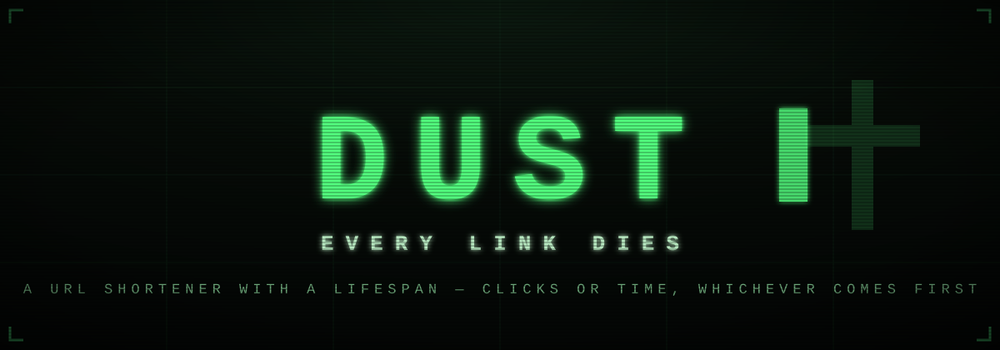
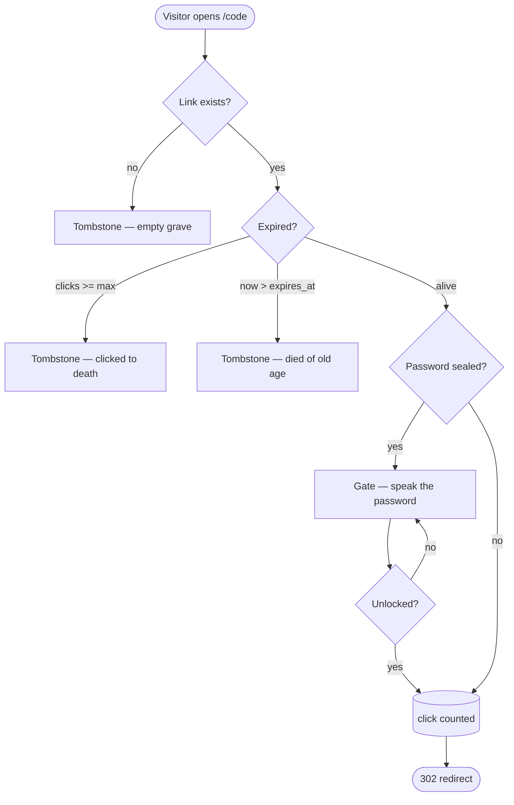

<div align="center">



**A URL shortener where every link is mortal.**

Shorten it. Choose how many clicks it survives and how long it lives —
whichever runs out first takes it. Watch it decay. Visit its tombstone.

[](https://nodejs.org)
[](https://expressjs.com)
[](https://nodejs.org/api/sqlite.html)
[](https://github.com/Mostakim52)

</div>

---

## The Twist

Every URL shortener makes links *live forever*. DUST is the opposite.

When you shorten a link, you seal its fate with **two lifespans**:

- **Clicks** — it dies after being used N times (1, 5, 10, 25, 100…)
- **Time** — it dies after N minutes, hours, or days (5m → 7d…)

Set both and the link dies **whichever comes first**. Set neither and you get an
immortal link — a bold, suspicious choice.

The dashboard — **The Vault** — is a mortuary terminal where every link drains
on a 10-segment vitality meter, green to amber to red, with live countdowns.
When a link dies, visitors don't get a boring 404. They get a **tombstone**,
with an epitaph and the deceased's life statistics:

> `† /fading`
> *This link died of old age.*
> lived for **5m 0s** · received **0** clicks · resting since **11:01:26 AM**

## How a Link Dies



Death is never stored — it is *computed* on every visit against the link's
lifespans, so a link that expires while the server is offline is still
correctly dead when it comes back.

## Features

- **Dual-lifespan decay** — click budget and TTL, intersected
- **The Vault** — live vitality meters, countdowns, click counters
- **Tombstone pages** — epitaphs and life stats for the deceased
- **Sealed links** — optional per-link password gate
- **QR codes** — generated on the fly for every link
- **Custom aliases** — or short random graves, generated for you
- **Zero native dependencies** — SQLite is built into Node itself
- **One aesthetic** — phosphor-green CRT terminal, scanlines and all

## Tech Stack

| Layer      | Choice                                            |
| ---------- | ------------------------------------------------- |
| Runtime    | Node.js `>= 22.13` (built-in `node:sqlite`)       |
| Server     | Express 5                                         |
| Database   | SQLite file (`links.db`), schema auto-created     |
| Frontend   | Vanilla HTML/CSS/JS — no framework, no build step |
| QR codes   | `qrcode`                                          |

## Quick Start

```bash
git clone https://github.com/Mostakim52/URL-Shortener.git
cd URL-Shortener
npm install
npm start
```

Open `http://localhost:3000` and bury your first link.

## API

| Method   | Route                 | Description                                   |
| -------- | --------------------- | --------------------------------------------- |
| `POST`   | `/api/shorten`        | Shorten a URL — accepts `url`, `alias`, `maxClicks`, `ttlMinutes`, `password` |
| `GET`    | `/api/links`          | List all specimens with decay state           |
| `DELETE` | `/api/links/:code`    | Kill a link immediately                       |
| `GET`    | `/api/qr/:code`       | QR code (data URL) for a link                 |
| `POST`   | `/api/unlock/:code`   | Unlock a sealed link with `{ "password" }`    |
| `GET`    | `/:code`              | Redirect — or tombstone / password gate       |

Example:

```bash
curl -X POST http://localhost:3000/api/shorten \
  -H "Content-Type: application/json" \
  -d '{ "url": "https://example.com", "maxClicks": 5, "ttlMinutes": 60 }'
```

## Deploy to Railway

DUST ships with `railway.json` and runs as a single long-lived process —
no external database services required.

1. Push this repository to GitHub
2. In [Railway](https://railway.app): **New Project → Deploy from GitHub repo**
3. **Add a Volume** to the service, mounted at `/data`, and set the variable
   `DB_PATH=/data/links.db` — this is what makes links survive redeploys
4. Generate a domain under **Settings → Networking** — done

| Variable   | Default              | Purpose                                  |
| ---------- | -------------------- | ---------------------------------------- |
| `PORT`     | injected by Railway  | Listen port                              |
| `DB_PATH`  | `./links.db`         | SQLite file location — point at a volume |
| `HOST`     | `0.0.0.0`            | Bind address                             |

## Project Structure

```
URL-Shortener/
├── server.js          # Express server, SQLite schema, tombstones & gates
├── railway.json       # Railway deployment config
├── package.json
├── public/            # The CRT dashboard — no build step
│   ├── index.html
│   ├── style.css
│   └── app.js
└── docs/
    └── banner.svg
```

---

<div align="center">

<a href="https://github.com/Mostakim52">
  
</a>

**MADE BY**

[**Mostakim Hossain**](https://github.com/Mostakim52) · [@Mostakim52](https://github.com/Mostakim52)

*Memento mori — all links return to dust.*

</div>
